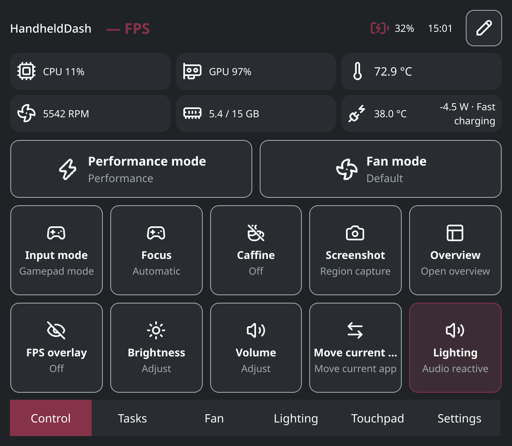

### Intro
**HandheldDash** is a touch-friendly control panel with a system D-Bus hardware service. The verified target is **AYN Thor running the Thorch BSP and KWin**. [Chinese documentation](README.zh-CN.md).

### Feature

- performance and fan profiles with editable fan curves
- dual-screen brightness and application placement
- task switching, region/top/bottom screenshots, playback volume 
- independent joystick lighting with audio-reactive output and color dials
- configurable Home/Back actions, and gamepad/mouse input profiles. 
- customizable control and monitoring cards, with optional load/network/disk-IO readings
- brightness/volume popups and native Plasma Mobile status-bar / Docked Mode settings
 
The daemon lets an active local user operate supported hardware without running the interface as root. [Features and limits](docs/features.md).

### Limitations
Gamepad focus only asks KWin to activate a window on the selected screen when controller activity is detected; it does **not** isolate or route gamepad input. Games reading SDL/evdev devices directly may respond simultaneously regardless of desktop focus. “Automatic” leaves focus unchanged. This feature depends on KWin and the recognized controller; reliable two-game input isolation has not been validated.

Gamepad/Mouse mode loads the system-installed InputPlumber profiles (`/usr/share/inputplumber/profiles/default.yaml` and `mouse_keyboard_wasd.yaml`) and adds HandheldDash button mappings at runtime. These base profiles are supplied by the system's InputPlumber installation, **not bundled with HandheldDash**; the supported Thorch setup must provide them and a compatible controller configuration.

Android partition access require custom kernel and is **extremely experimental: it may not work and may even prevent Android from booting**. 

Wider device support is planned; unsupported controller layouts and bypass charging are to be supported by upstream driver. 

UI, application services, desktop adapters and hardware integrations have separate modules. Other desktop sessions use capability-limited fallback. See [project structure and package deployment](docs/portability.md).
### Install

On a compatible Thorch installation, download lateset release from [Releases](https://github.com/lurenjiamax/HandheldDash/releases), 

#### Manual Install
1. Enable SSH, and use scp to transport the release into your device. Or download the package on your handheld device.

2. Install it with `sudo pacman -U <Package>`

3. Run 
```bash
sudo systemctl enable --now inputplumber.service aynthor-hardwared.service 
systemctl --user enable --now aynthor-control.service
```

Press the AYN key to toggle the panel. Or run `handhelddash`, open `handhelddash --settings`, or see [Installation, upgrades and source builds](docs/installation.md). FPS limits and the optional in-game overlay require explicitly launching applications through MangoHud, for example `mangohud eden`. The dashboard does not collect or display FPS. Taking over the MangoHud configuration does not load MangoHud into an application.

### License
Original project code is licensed under **LGPL-3.0-or-later**; see [LICENSE](LICENSE) and [COPYING](COPYING). Vendored lpunpack, Tabler and Lucide icons retain their LGPL, MIT and ISC notices; dependencies retain their own licenses, including PyQt6's GPL/commercial terms.

This is community software without warranty, and hardware support must not be assumed beyond AYN. [Third-party notices](docs/third-party.md).
